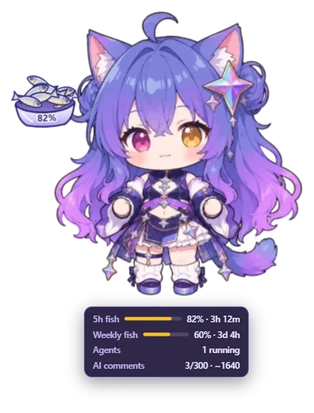
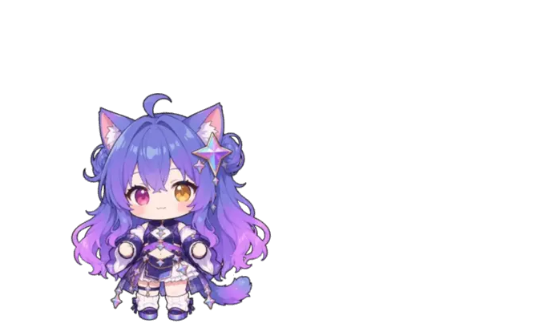
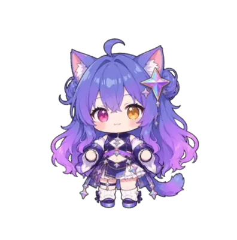
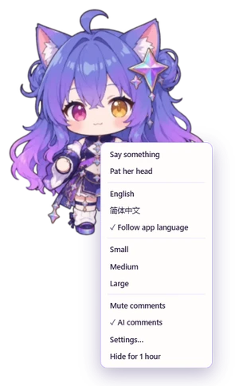
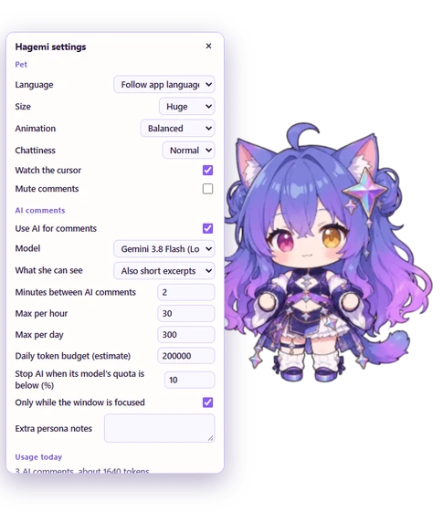
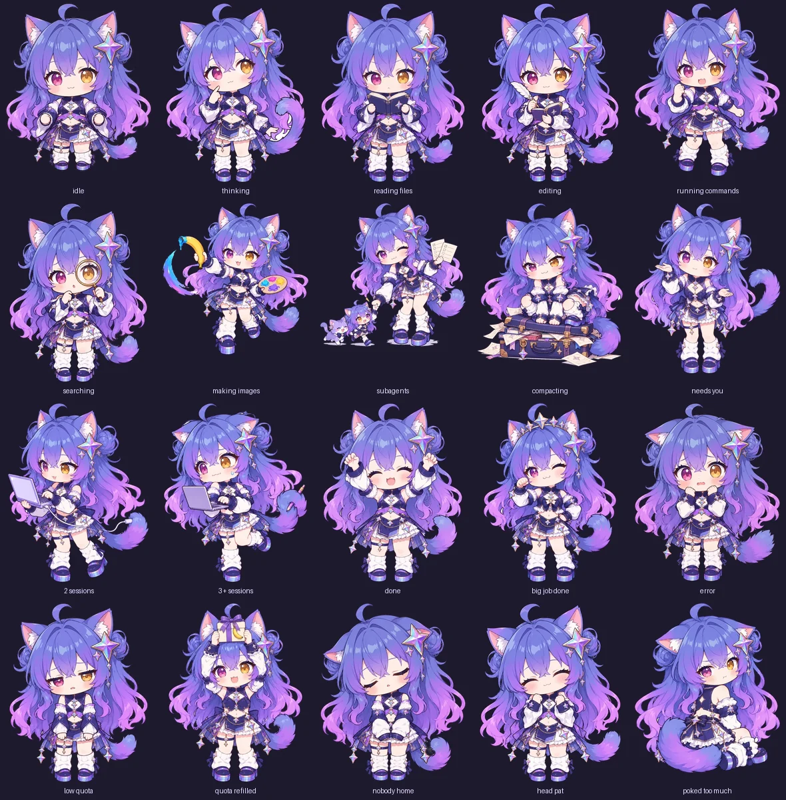

<div align="center">


# Hagemi Pet for Antigravity

A chibi Gemini catgirl who lives in your [Antigravity](https://antigravity.google) window, watches your agents work, and has opinions about it.

**English** · [简体中文](README.zh-CN.md)


</div>

Hagemi (哈基米) is what Chinese fans call Gemini, and also a meme about cats. So she is a cat: your quota is her stash of 小鱼干 (dried fish), and every subagent is a tiny copy of her.

## She works alongside you

<table>
<tr>
<td width="300" align="center"></td>
<td>

**She acts out what your agent is doing.** Reading files, writing code, running commands, searching the web, drawing images: each has its own pose. When an agent is stuck waiting for your answer, she waves you over.

</td>
</tr>
<tr>
<td width="300" align="center"></td>
<td>

**She reacts when a job ends.** A cheer for a finished task, a victory spin after a big one, and a flustered apology when something breaks, even when it was not her fault.

</td>
</tr>
<tr>
<td width="300" align="center"></td>
<td>

**Subagents are tiny Hagemis.** Each running subagent gets a little clone floating beside her. Run a lot of them and she gets very smug about it.

</td>
</tr>
</table>

## She keeps an eye on your quota

<table>
<tr>
<td width="300" align="center"></td>
<td>

**Quota is her dried fish.** As it runs low she droops and her fish dish appears, emptier as it drains. When the quota is about to reset she perks up, and when it refills: a gift box and a shower of fish.

</td>
</tr>
<tr>
<td width="300" align="center"></td>
<td>

**Hover over her** to see how much quota is left, when it resets, and how many agents are running.

</td>
</tr>
</table>

## She has feelings

<table>
<tr>
<td width="300" align="center"></td>
<td>

**Pat her head** and she purrs. **Poke her** and she goes from surprised to annoyed to puffed up to red hot, then sulks and ignores you. A head pat makes up for it.

</td>
</tr>
<tr>
<td width="300" align="center"></td>
<td>

**Drag her anywhere.** Her hair and tail trail behind her. Throw her and she glides and bounces off the edges. Shake her hard and she gets dizzy.

</td>
</tr>
<tr>
<td width="300" align="center"></td>
<td>

**Tuck her into a window edge** and she hides there, peeking out when your cursor comes close.

</td>
</tr>
</table>

## She knows what time it is

- A different greeting for morning, noon, afternoon, evening and night.
- Up past 1am? She will tell you to sleep. Working for two hours straight? Time to stretch.
- Festival outfits on Halloween, Christmas, New Year, Chinese New Year, the Lantern, Dragon Boat and Mid-Autumn festivals, and National Day.
- Switch your agent to Claude or GPT and she gets jealous. Switch back and all is forgiven.

## She speaks English and 简体中文

<table>
<tr>
<td width="300" align="center"></td>
<td>

She follows Antigravity's language by default, or you can pick one. Her personality takes after the playful Gemini-musume drawn and voiced by Bilibili creators.

</td>
</tr>
</table>

## Install

You need the Antigravity **desktop app**. She does not appear in the CLI, the IDE extensions or the Remote Control web client.

Install her with the Antigravity CLI:

```bash
agy plugin install https://github.com/KCFindstr/hagemi-pet-agy
```

She appears in the bottom right within about 30 seconds. If she does not, restart Antigravity once.

To remove her, turn her off first, then uninstall:

```bash
agy plugin disable hagemi-pet-agy
```

```bash
agy plugin uninstall hagemi-pet-agy
```

Her settings are kept in case she comes back.

## AI comments

Most of what she says is written by hand. For bigger moments, like a finished job, a failure or a quota change, she can ask a model for a fresh comment instead, marked with ✦. It uses your Antigravity account and counts toward your normal quota, so there is no API key to set up.

The defaults are generous but capped:

- **Model:** Gemini 3.8 Flash (Low), the cheapest. You can pick any model in your list.
- **How often:** at most one comment every 2 minutes, 30 an hour and 300 a day.
- **When:** only while the Antigravity window is in front, and never once that model's quota is below 5%.
- **Repeats:** never the same situation twice within 6 hours.

Turn AI off and she keeps every hand-written line.

### What the model sees

Set this under *What she can see*:

- **Only numbers and tool names:** counts, durations, quota and the time.
- **Also chat titles.**
- **Also short excerpts** (default): up to about 100 characters of your last message and 130 of the agent's. Code blocks, links, file paths, long blobs and anything shaped like a credential are removed first.

Excerpts go to the model you selected, which may not be the one the conversation uses. Keystroke *timing* is used to avoid talking over you; the keys themselves are never read. Nothing is stored except her settings and the daily tally.

## Settings

Right-click her for quick options, or choose **Settings…** for everything: language, size, animation quality, how chatty she is, whether she follows your cursor, the AI limits, and extra notes for her personality. Double-click her to make her say something.

<p align="center">
&nbsp;&nbsp;&nbsp;

</p>

## Good to know

- She lives in the desktop app only. She does not appear in the Remote Control web client, but she keeps watching on your computer and is caught up when you come back.
- She watches from the side, so she never slows your agents down.
- She relies on parts of Antigravity that are not officially documented, so an Antigravity update could stop her from appearing or reacting. Nothing else in the app depends on her.
- Tested on Windows. macOS and Linux should work but have not been tried yet.

## All her poses



Curious how she works, or want to change her? See [docs/DEVELOPMENT.md](docs/DEVELOPMENT.md).

## Credits

Inspired by [CrossPet](https://github.com/lokicorvus/crosspet) by lokicorvus and contributors, a desktop pet that acts out what your AI is doing. CrossPet's code is under the [MIT License](https://github.com/lokicorvus/crosspet/blob/main/LICENSE) and its artwork, including the character art used here, is under [CC BY-NC-SA 4.0](https://github.com/lokicorvus/crosspet/blob/main/characters/LICENSE.md). You can also read this in the app: right-click her and choose **Settings…**.

## License

- **Code:** [MIT](LICENSE).
- **Art:** [CC BY-NC-SA 4.0](https://creativecommons.org/licenses/by-nc-sa/4.0/), from [CrossPet](https://github.com/lokicorvus/crosspet). This is **non-commercial and share-alike**, so distributing this plugin with its art must stay non-commercial. See [NOTICE.md](NOTICE.md) for credits and details.

This is an unofficial fan project, not affiliated with Google. Thanks to lokicorvus and the CrossPet contributors for the art, and to the Bilibili creators whose Gemini-musume made her who she is.
