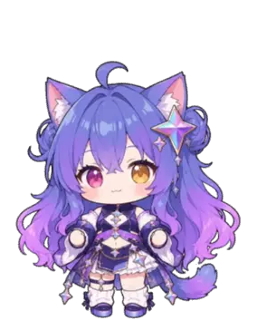
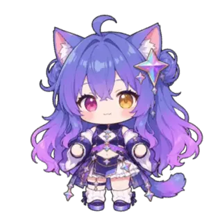
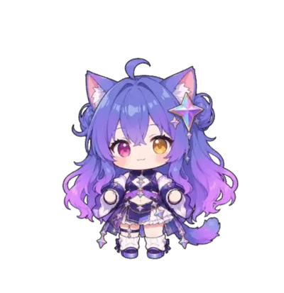
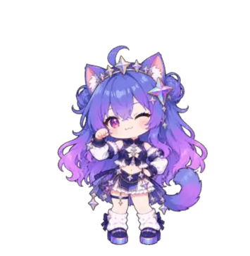
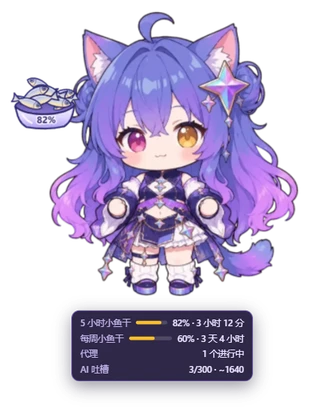
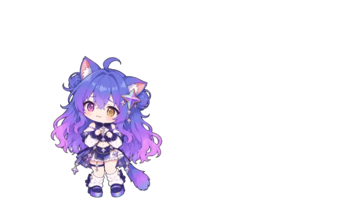
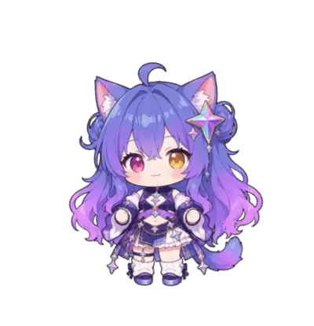
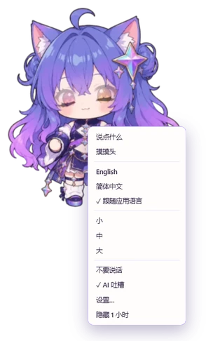
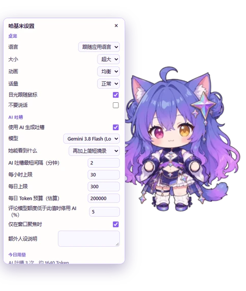
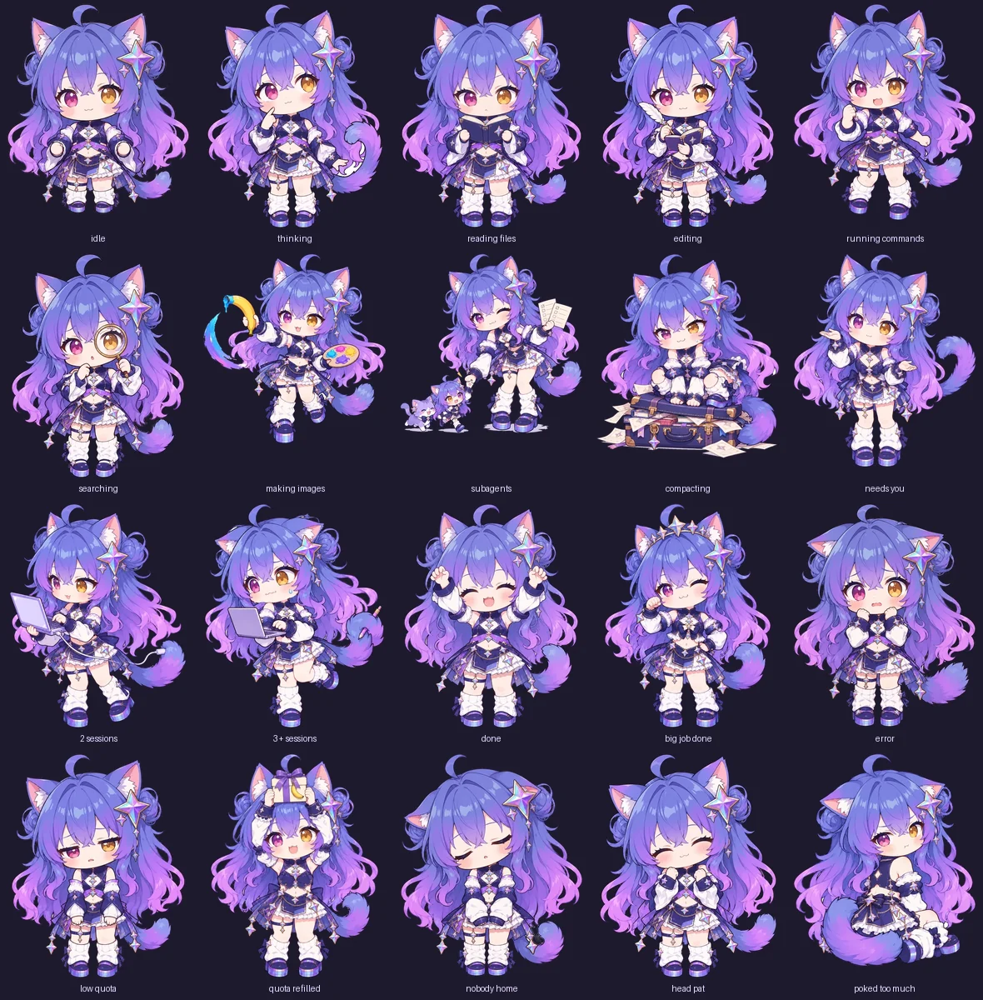

<div align="center">


# 哈基米桌宠 · Antigravity 插件

一只住在 [Antigravity](https://antigravity.google) 窗口里的 Q 版 Gemini 猫娘，看着你的代理干活，还很有自己的想法。

[English](README.md) · **简体中文**



</div>

## 她陪你一起干活

<table>
<tr>
<td width="300" align="center"></td>
<td>

**你的代理在做什么，她就演什么。** 读文件、写代码、跑命令、上网搜索、画图，各有各的姿势。代理等你回复时，她会招手叫你过来。

</td>
</tr>
<tr>
<td width="300" align="center"></td>
<td>

**任务结束时她会有反应。** 完成了就欢呼，大活干完转个圈庆祝，出错了就慌忙道歉，哪怕根本不是她的错。

</td>
</tr>
<tr>
<td width="300" align="center"></td>
<td>

**子代理就是迷你哈基米。** 每个运行中的子代理都会变成一只小分身飘在她旁边。开得越多，她越得意。

</td>
</tr>
</table>

## 她帮你盯着额度

<table>
<tr>
<td width="300" align="center"></td>
<td>

**额度就是她的小鱼干。** 额度变少时她会蔫下去，旁边出现鱼盘，鱼越来越少。额度快重置时她会打起精神，补满时：礼物盒加一场小鱼干雨。

</td>
</tr>
<tr>
<td width="300" align="center"></td>
<td>

**把鼠标停在她身上**，可以看到剩余额度、重置时间和正在运行的代理数量。

</td>
</tr>
</table>

## 她是有脾气的

<table>
<tr>
<td width="300" align="center"></td>
<td>

**摸摸头**她会呼噜。**一直戳她**，她会从吃惊到不耐烦，再到气鼓鼓，再到炸毛，最后生闷气不理你。摸摸头就好了。

</td>
</tr>
<tr>
<td width="300" align="center"></td>
<td>

**随便拖她到哪里。** 头发和尾巴会跟着飘。把她扔出去，她会滑行并在边缘反弹。使劲晃她会晕。

</td>
</tr>
<tr>
<td width="300" align="center"></td>
<td>

**把她塞到窗口边缘**，她会躲在那里，鼠标靠近时探出头来。

</td>
</tr>
</table>

## 她知道现在几点

- 早上、中午、下午、傍晚和夜里各有不同的问候。
- 过了凌晨一点还在干活？她会催你睡觉。连续工作两小时？该伸个懒腰了。
- 万圣节、圣诞节、元旦、春节、元宵、端午、中秋和国庆都有节日装扮。
- 把代理换成 Claude 或 GPT，她会吃醋。换回来就原谅你。

## 她会说中文和英文

<table>
<tr>
<td width="300" align="center"></td>
<td>

默认跟随 Antigravity 的语言，也可以手动选择。

</td>
</tr>
</table>

## 安装

需要 Antigravity **桌面应用**。她不会出现在 CLI、IDE 扩展和远程控制网页端里。

用 Antigravity CLI 安装：

```bash
agy plugin install https://github.com/KCFindstr/hagemi-pet-agy
```

大约 30 秒内她就会出现在右下角。如果没有，重启一次 Antigravity。

卸载时先关掉她，再卸载：

```bash
agy plugin disable hagemi-pet-agy
```

```bash
agy plugin uninstall hagemi-pet-agy
```

她的设置会保留，方便她回来。

## AI 吐槽

她说的话大多是手写的台词。遇到大一点的时刻，比如任务完成、出错或额度变化，她会请模型现编一句吐槽，带 ✦ 标记。调用使用你的 Antigravity 账号，计入你的正常额度，不需要配置 API Key。

默认值比较宽松，但有上限：

- **模型：** Gemini 3.8 Flash (Low)，最省的版本。可以换成你列表里的任何模型。
- **频率：** 两次吐槽至少间隔 2 分钟，每小时最多 30 次，每天最多 300 次。
- **Token 预算：** 每天 200,000（估算值，包含提示词和回复）。
- **时机：** 只在 Antigravity 窗口在前台时调用，该模型额度低于 10% 时不再调用。
- **重复：** 同样的情况 6 小时内不会再问。

关掉 AI 后，所有手写台词依然都在。

### 模型能看到什么

在「她能看到什么」里设置：

- **只有数字和工具名：** 次数、时长、额度和时间。
- **加上对话标题。**
- **再加上简短摘录**（默认）：你最后一句话约 200 字以内，代理最后一句话约 1000 字以内。代码块、链接、文件路径、长串字符和形似密钥的内容会先被移除。

摘录会发给你选的模型，它不一定是当前对话正在用的模型。她只用按键的*时间*来避免打断你，绝不读取按键内容。除了设置和当天用量，什么都不保存。

## 设置

右键点她可以快速调整，选择 **设置…** 可以修改全部选项：语言、大小、动画质量、话量、目光跟随、AI 限制，以及额外的人设说明。双击她可以让她说句话。

<p align="center">
&nbsp;&nbsp;&nbsp;

</p>

## 须知

- 她只住在桌面应用里。远程控制的网页端看不到她，但她会在你的电脑上继续关注，回来时状态是最新的。
- 她从旁观察，不会拖慢你的代理。
- 她用到了 Antigravity 未公开的部分，所以 Antigravity 更新后她可能不再出现或不再有反应。应用本身不依赖她。
- 已在 Windows 上测试。macOS 和 Linux 理论上可用，但还没试过。

## 她的全部姿势



想知道她的工作原理，或者想修改她？请看 [docs/DEVELOPMENT.zh-CN.md](docs/DEVELOPMENT.zh-CN.md)。

## 致谢

灵感来自 lokicorvus 及贡献者的 [CrossPet](https://github.com/lokicorvus/crosspet)，一款会跟着 AI 做动作的桌宠。CrossPet 的代码采用 [MIT 许可](https://github.com/lokicorvus/crosspet/blob/main/LICENSE)，美术（包括这里使用的角色美术）采用 [CC BY-NC-SA 4.0](https://github.com/lokicorvus/crosspet/blob/main/characters/LICENSE.md)。在应用里也能看到这些信息：右键点她，选择 **设置…**。

## 许可

- **代码：** [MIT](LICENSE)。
- **美术：** [CC BY-NC-SA 4.0](https://creativecommons.org/licenses/by-nc-sa/4.0/deed.zh-hans)，来自 [CrossPet](https://github.com/lokicorvus/crosspet)。

这是非官方同人项目，与 Google 无关。感谢 lokicorvus 和 CrossPet 贡献者的美术！
